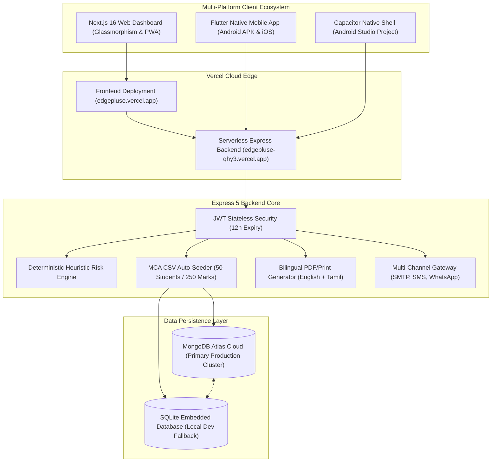

# EduPulse – Next-Gen Student Analytics & Automated Parent Alerts

<div align="center">


-black?style=for-the-badge&logo=next.js)


**An institutional academic intelligence and automated parental communication ecosystem bridging administrative rosters, real-time CAT examinations, and multi-channel student risk alerts.**

[🌐 Live Web Application](https://edgepluse.vercel.app) • [⚡ Live API Backend](https://edgepluse-qhy3.vercel.app/api) • [📱 Android APK Download](#-mobile-applications-flutter--capacitor) • [📂 GitHub Repository](https://github.com/awielabs/edgepluse)

</div>

---

## 📑 Table of Contents
1. [Executive Summary & Production Deployment](#-executive-summary--production-deployment)
2. [End-to-End System Architecture](#-end-to-end-system-architecture)
3. [Institutional Context & MCA Roster](#-institutional-context--mca-roster)
4. [Technology Stack](#-technology-stack)
5. [Repository Structure](#-repository-structure)
6. [API Endpoints Reference](#-api-endpoints-reference)
7. [Local Development & Setup Guide](#-local-development--setup-guide)
8. [Mobile Applications (Flutter & Capacitor)](#-mobile-applications-flutter--capacitor)
9. [MongoDB Atlas Cloud Configuration](#-mongodb-atlas-cloud-configuration)
10. [Cloud Deployment Guide (Vercel)](#-cloud-deployment-guide-vercel)

---

## 🚀 Executive Summary & Production Deployment

EduPulse provides academic faculty and institutional administrators with a unified platform to track student attendance, record continuous assessment test (CAT) marks, evaluate risk factors using deterministic heuristics, and automatically notify parents through multi-channel gateways.

### 🌐 Live Production Endpoints

| Component | Target URL | Status | Description |
| :--- | :--- | :--- | :--- |
| **Web Frontend** | [https://edgepluse.vercel.app](https://edgepluse.vercel.app) | `🟢 Live` | Next.js 16 glassmorphic web dashboard |
| **RESTful API** | [https://edgepluse-qhy3.vercel.app/api](https://edgepluse-qhy3.vercel.app/api) | `🟢 Live` | Express serverless backend on Vercel |
| **Cloud Database** | `cluster0.ey3rp.mongodb.net` | `🟢 Live` | MongoDB Atlas cluster (`edupulse` database) |
| **Android APK** | [app-debug.apk](edupulse_mobile/build/app/outputs/flutter-apk/app-debug.apk) | `🟢 Compiled` | Native Flutter APK for Android phones |

### 🔑 Default Institutional Credentials

| Role | Username | Password | Access Privileges |
| :--- | :--- | :--- | :--- |
| **Administrator** | `admin` | `admin123` | Full access: roster management, settings, thresholds, SMS/SMTP gateways |
| **Faculty Member** | `faculty` | `faculty123` | Attendance roll-call, marks entry, student view, progress report generation |

---

## 🏛️ End-to-End System Architecture



---

## 🎓 Institutional Context & MCA Roster

EduPulse is pre-configured for **Manakula Vinayagar Institute of Technology (Autonomous)**:
- **Programme**: Master of Computer Applications (MCA)
- **Cohort**: Semester 3 (Second Year)
- **Assessment**: Continuous Assessment Test 1 (CAT-1)
- **Curricular Subjects Tracked**:
  1. `DS`: Data Structures & Algorithms
  2. `.NET`: .NET Framework Programming
  3. `FD`: Full Stack Development
  4. `CC`: Cloud Computing
  5. `MA`: Mobile Applications Development

### 📄 Bilingual Progress Report Format
The progress reports follow the official institutional letterhead format:
- Student Registration Number, Roll Number, and Attendance Days.
- Maximum marks (`50`) scaled with conversion percentage (`100%`).
- **Bilingual Performance Remarks (English + Tamil)**:
  - `Excellent` &rarr; *"மிகவும் நன்று (Keep up the outstanding performance)"*
  - `Needs Attention` &rarr; *"கவனம் தேவை (Immediate improvement required)"*

---

## 🛠️ Technology Stack

| Layer | Framework / Library | Role & Functionality |
| :--- | :--- | :--- |
| **Web Frontend** | Next.js 16 (React 19), Vanilla CSS | Ultra-modern glassmorphic design system with ambient glow orbs |
| **Icons & Micro-UI** | `lucide-react`, `canvas-confetti` | High-fidelity vector icons and completion animations |
| **Mobile App** | Flutter 3.44.4 (Dart 3.12) | Native cross-platform mobile experience (Android / iOS) |
| **Hybrid Wrapper** | `@capacitor/core`, `@capacitor/android` | Instant packaging of Next.js frontend into native Android Studio shell |
| **Backend Engine** | Node.js (v22+), Express 5 | High-throughput REST API with CORS and serverless cold-start handling |
| **Primary Database** | MongoDB Atlas (`mongoose`) | Cloud document store (`students`, `marks`, `attendances`, `users`, `settings`) |
| **Fallback Database**| `node:sqlite` (`DatabaseSync`) | Zero-config local SQLite running in WAL mode |
| **Alert Gateways** | `nodemailer`, Twilio API | Multi-channel parent alerts (Email SMTP, SMS, WhatsApp) |
| **Hosting Platform** | Vercel Edge Network | Global CDN deployment with continuous Git integration |

---

## 📁 Repository Structure

```text
edupulse/
├── edupulse/                          # Express.js REST API Backend
│   ├── server.js                      # Core Express server & API routes
│   ├── mongo.js                       # Mongoose schemas & Atlas connection logic
│   ├── mcaSeeder.js                   # CSV ingestion engine for MCA dataset
│   ├── MCA_Students_5_Subjects.csv    # Official roster (50 MCA students)
│   ├── vercel.json                    # Vercel serverless routing configuration
│   ├── .env                           # Cloud environment variables (ignored in Git)
│   └── .env.example                   # Environment configuration template
│
├── frontend/                          # Next.js 16 Glassmorphism Web App
│   ├── src/
│   │   ├── app/
│   │   │   ├── layout.js              # HTML root with safe-area insets & metadata
│   │   │   ├── page.js                # Dynamic view switcher with auth gates
│   │   │   └── globals.css            # Glassmorphism design system & token definitions
│   │   ├── components/
│   │   │   ├── views/                 # Modular dashboard views
│   │   │   │   ├── DashboardView.js   # Analytics overview & quick statistics
│   │   │   │   ├── StudentsView.js    # Student roster search & filter
│   │   │   │   ├── AttendanceView.js  # Interactive roll-call module
│   │   │   │   ├── MarksView.js       # CAT-1 subject marks entry
│   │   │   │   ├── AttentionView.js   # At-risk students heuristics monitor
│   │   │   │   ├── ReportsView.js     # Progress report card generator
│   │   │   │   └── SettingsView.js    # Thresholds, MongoDB & gateway settings
│   │   │   ├── MobileBottomNav.js     # Native mobile bottom navigation bar
│   │   │   └── InstallPrompt.js       # PWA one-tap installation banner
│   │   └── lib/
│   │       └── api.js                 # Unified fetch client with JWT injection
│   ├── public/
│   │   ├── manifest.json              # Progressive Web App manifest
│   │   └── sw.js                      # Offline caching service worker
│   ├── android/                       # Native Android project (Capacitor)
│   ├── ios/                           # Native iOS project (Capacitor)
│   ├── capacitor.config.json          # Mobile wrapper configuration
│   └── next.config.mjs                # Production API rewrites proxy
│
├── edupulse_mobile/                   # Native Flutter Mobile Application
│   ├── lib/
│   │   └── main.dart                  # Material 3 dark glassmorphic mobile app
│   ├── pubspec.yaml                   # Flutter dependencies (http, shared_preferences)
│   └── build/app/outputs/flutter-apk/ # Generated Android APK binaries
│
├── ATLAS_SETUP_GUIDE.md               # 1-minute MongoDB Atlas IP whitelist guide
├── WORKFLOW_DOCUMENTATION.md          # Architectural workflow and data flows
└── README.md                          # Primary project documentation
```

---

## ⚡ API Endpoints Reference

All API routes are served under `/api` and secured with Bearer JWT tokens (except `/login`).

### Authentication & Meta
- `POST /api/login` &rarr; Authenticate staff credentials (`admin` / `faculty`) and receive JWT token.
- `GET /api/meta` &rarr; Return departments, academic years, sections, active database engine, and connection status.

### Student Rosters & Seeding
- `GET /api/students` &rarr; Retrieve all students with optional filters (`?department=MCA&search=Sameer`).
- `POST /api/students` &rarr; Create a new student profile.
- `PUT /api/students/:id` &rarr; Update existing student details.
- `DELETE /api/students/:id` &rarr; Remove student (Admin only).
- `POST /api/students/seed-mca` &rarr; Reset and re-seed the complete 50 MCA students and 250 marks from CSV.

### Academic Records & Reports
- `POST /api/attendance` &rarr; Record bulk daily attendance (`Present` / `Absent`).
- `POST /api/marks` &rarr; Submit exam marks for a specific subject and exam cycle.
- `GET /api/reports/attendance` &rarr; Aggregate cumulative attendance percentages per student.
- `GET /api/reports/marks` &rarr; Subject-wise gradebook report with pass/fail evaluation.
- `GET /api/reports/performance` &rarr; Academic risk status report (`On track`, `Needs attention`).

### Cloud Database & Settings
- `GET /api/settings` &rarr; Retrieve institutional alert thresholds and channel statuses.
- `PUT /api/settings` &rarr; Update threshold values and notification credentials.
- `POST /api/settings/mongodb` &rarr; Test and hot-connect a MongoDB Atlas cloud URI.

---

## 💻 Local Development & Setup Guide

### Prerequisites
- **Node.js**: v22.0.0 or higher
- **Flutter SDK**: v3.40+ (optional, for Flutter app)
- **Git**

### 1. Start the Express Backend
```bash
cd edupulse
npm install
node server.js
```
*Backend runs on `http://localhost:5000`.*

### 2. Start the Next.js Frontend
```bash
cd frontend
npm install
npm run dev
```
*Frontend runs on `http://localhost:3000`.*

---

## 📱 Mobile Applications (Flutter & Capacitor)

EduPulse provides two enterprise-grade mobile deployment options:

### Option A: Native Flutter Application (`edupulse_mobile`)
The Flutter app provides a 100% native dark glassmorphic client directly connected to `https://edgepluse-qhy3.vercel.app/api`.

- **To run on desktop / web:**
  ```bash
  cd edupulse_mobile
  flutter run -d chrome
  ```
- **To build a release Android APK:**
  ```bash
  cd edupulse_mobile
  flutter build apk --release
  ```
- **Compiled APK Location:**
  [`edupulse_mobile/build/app/outputs/flutter-apk/app-debug.apk`](edupulse_mobile/build/app/outputs/flutter-apk/app-debug.apk)

### Option B: Capacitor Native Shell (`frontend/android`)
Packages the Next.js web application directly into native Android Studio and Xcode projects:
```bash
cd frontend
npm run cap:sync
npm run cap:open:android
```

---

## ☁️ MongoDB Atlas Cloud Configuration

EduPulse uses **MongoDB Atlas** as its cloud database.

1. **Connection String Format**:
   ```env
   MONGODB_URI=mongodb+srv://<username>:<password>@cluster0.ey3rp.mongodb.net/edupulse?retryWrites=true&w=majority
   ```
2. **Network Firewall Configuration**:
   - Log into [MongoDB Atlas Console](https://cloud.mongodb.com).
   - In the sidebar under **Security**, navigate to **Network Access**.
   - Click **+ Add IP Address** &rarr; select **Allow Access From Anywhere (`0.0.0.0/0`)** &rarr; click **Confirm**.
3. **Verification**:
   - Open **Settings** in the EduPulse web app and click **`Test This Saved Connection`**.

---

## 🚀 Cloud Deployment Guide (Vercel)

Both the backend and frontend are optimized for zero-configuration deployment on Vercel:

1. **Deploy Backend (`edupulse` root)**:
   - Import `awielabs/edgepluse` on [Vercel](https://vercel.com/new).
   - Set **Root Directory** to `edupulse`.
   - Add Environment Variables:
     - `MONGODB_URI`: Your MongoDB Atlas URI.
     - `JWT_SECRET`: Secure encryption secret.
   - Click **Deploy**.

2. **Deploy Frontend (`frontend` root)**:
   - Import `awielabs/edgepluse` again on Vercel.
   - Set **Root Directory** to `frontend`.
   - Add Environment Variable:
     - `NEXT_PUBLIC_API_URL`: Your deployed backend URL (`https://edgepluse-qhy3.vercel.app`).
   - Click **Deploy**.

---

<div align="center">

**EduPulse Academic Intelligence Ecosystem**  
*Developed for Manakula Vinayagar Institute of Technology (Autonomous)*  
Built with ❤️ using Next.js 16, Express 5, MongoDB Atlas, and Flutter.

</div>
