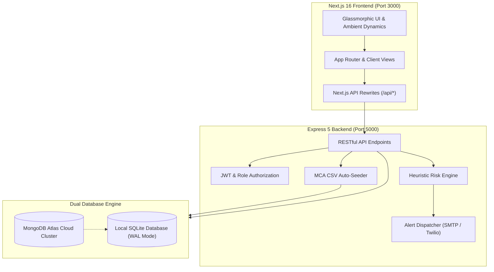
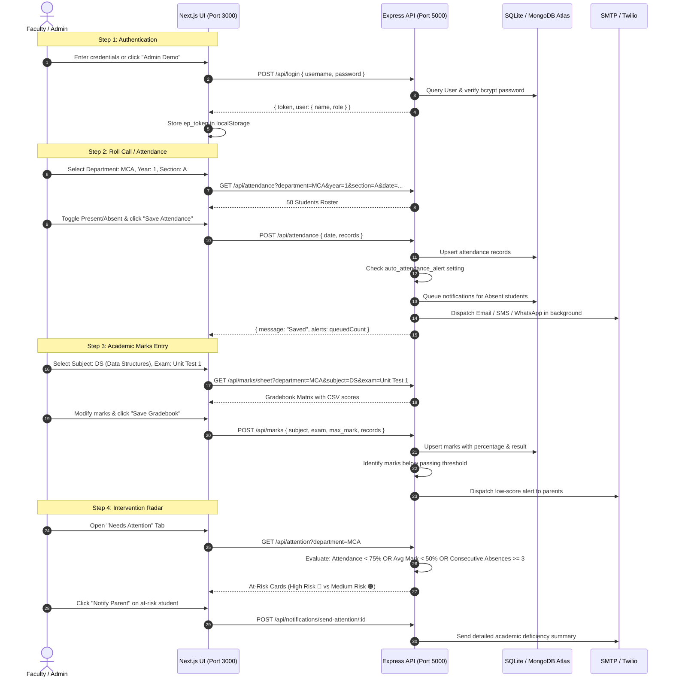

# EduPulse – Complete System Architecture & Workflow Documentation

---

## 1. Executive Summary & Architecture Overview

**EduPulse** is an enterprise-grade academic intelligence and automated parent communication platform. It bridges classroom administration with proactive parental engagement through automated absence detection, academic risk heuristics, and multi-channel notification dispatch.

### High-Level Architecture



---

## 2. Technology Stack

| Layer | Technology | Purpose |
| :--- | :--- | :--- |
| **Frontend** | Next.js 16 (App Router), React 19, Vanilla CSS | Glassmorphism design system, ambient orbs, reactive components |
| **Icons & Effects** | `lucide-react`, `canvas-confetti` | High-fidelity icons, micro-animations, celebration effects |
| **Backend** | Node.js (v22+), Express 5 | High-performance RESTful API, CORS-enabled |
| **Authentication** | JWT (`jsonwebtoken`), `bcryptjs` | Stateless session management with 12-hour expiry |
| **Primary Database** | MongoDB Atlas (`mongoose`) | Cloud-hosted document store with schema validation |
| **Fallback Database** | Built-in `node:sqlite` (DatabaseSync) | Zero-configuration local database in WAL mode |
| **Notification Gateways** | `nodemailer`, Twilio REST API | Multi-channel dispatch (Email SMTP, SMS, WhatsApp) |

---

## 3. Installation, Configuration & Startup

### Directory Structure
```
c:\Users\shovi\Downloads\edupulse\
├── MCA_Students_5_Subjects.csv     # 50 MCA Student records with marks & attendance
├── WORKFLOW_DOCUMENTATION.md       # Full workflow documentation (this file)
├── edupulse/                       # Express Backend
│   ├── .env                        # Active environment configuration
│   ├── .env.example                # Configuration template
│   ├── edupulse.db                 # Local SQLite database file
│   ├── mcaSeeder.js                # CSV seeder engine
│   ├── mongo.js                    # MongoDB Atlas schemas & connector
│   ├── package.json
│   └── server.js                   # Main Express application
└── frontend/                       # Next.js 16 Frontend
    ├── next.config.mjs             # Rewrites to port 5000
    ├── package.json
    └── src/
        ├── app/
        │   ├── globals.css         # Glassmorphism design system
        │   ├── layout.js
        │   └── page.js             # Root shell & view router
        ├── components/
        │   ├── FilterBar.js        # Dynamic class dropdowns
        │   ├── Login.js            # Glassmorphic auth card
        │   ├── Sidebar.js          # Navigation drawer
        │   ├── Toast.js            # Global alert toasts
        │   └── views/              # 9 core operational views
        └── lib/
            └── api.js              # Fetch client with auto JWT
```

### Environment Configuration (`edupulse/.env`)
```ini
PORT=5000
JWT_SECRET=edupulse-super-secret-jwt-key

# MongoDB Atlas Connection URI
# Leave empty to use local SQLite, or provide your cloud cluster URI:
MONGODB_URI=mongodb+srv://<username>:<password>@cluster0.mongodb.net/edupulse?retryWrites=true&w=majority

DB_FILE=edupulse.db
```

### Running the Services

1. **Start the Express Backend**:
   ```bash
   cd c:\Users\shovi\Downloads\edupulse\edupulse
   npm start
   # Server listens on http://localhost:5000
   ```

2. **Start the Next.js Frontend**:
   ```bash
   cd c:\Users\shovi\Downloads\edupulse\frontend
   npm run dev
   # Application accessible at http://localhost:3000
   ```

---

## 4. Database Layer & MCA CSV Seeding Engine

### Dual-Database Synchronization
- **Zero-Dependency Startup**: The server starts instantly with local SQLite (`node:sqlite`).
- **MongoDB Atlas Cloud Connection**: When `MONGODB_URI` is provided (either via `.env` or saved through the **Settings** UI), the backend automatically verifies the cluster connection, creates schemas, and synchronizes all SQLite data to MongoDB Atlas.

### MCA CSV Data Integration (`MCA_Students_5_Subjects.csv`)
On startup, [`mcaSeeder.js`](file:///c:/Users/shovi/Downloads/edupulse/edupulse/mcaSeeder.js) automatically reads the CSV file and populates the database:
- **50 Enrolled MCA Students**: Register numbers `250111` through `250250` (AARTHI.G, ABDUL WADOOD.M, etc.).
- **250 Examination Marks**: Parsed across 5 subjects:
  1. `DS`: Data Structures
  2. `.NET`: .NET Programming
  3. `FD`: Front-end Development
  4. `CC`: Cloud Computing
  5. `MA`: Mobile Applications
- **700 Attendance Entries**: 14-day attendance histories reconstructed to match each student's `attendance_percent` from the CSV.

---

## 5. End-to-End Operational Workflow



---

## 6. Detailed Feature-by-Feature User Guide

### 1. Authentication Screen
- **URL**: `http://localhost:3000/`
- **Features**:
  - Translucent frosted glass card with glowing borders.
  - Quick 1-click **Admin Demo** (`admin` / `admin123`) and **Faculty Demo** (`faculty` / `faculty123`) buttons.
  - Form validation with inline error messaging.

### 2. Academic Command Center (Dashboard)
- **Features**:
  - **KPI Metric Tiles**: Total Students, Present Today, Absent Today, Avg Attendance %, Avg Score %, Students Requiring Attention, Parent Alerts Dispatched.
  - **Gateway Status Diagnostic**: Live status pills for Email (SMTP), SMS (Twilio), and WhatsApp (Twilio).
  - **Department Distribution**: Visual progress bars displaying student enrollment counts per department.
  - **Quick Shortcuts**: Direct access to Mark Attendance and Enter Marks.

### 3. Student Registry (`/students`)
- **Features**:
  - Live search filtering by name or roll number.
  - Dropdown filter by Department, Year, and Section. Selecting **MCA** lists all 50 CSV students.
  - **Add Student Modal**: Full validation for student credentials and parent email/phone numbers.
  - **Bulk CSV Upload Modal**:
    1. Download standard template button.
    2. Real-time file parser with validation preview (counts valid vs invalid rows).
    3. 1-click confirm and batch import.

### 4. Daily Attendance Register (`/attendance`)
- **Features**:
  - **Auto-Fill Class Filter**: Selecting **MCA** automatically populates Year **1** and Section **A**, immediately loading the 50 students.
  - **Interactive Toggles**: Custom glass toggle buttons for 🟢 Present and 🔴 Absent.
  - **Batch Action**: "Mark All Present" button.
  - **Live Roll Summary**: Counter chip showing present vs absent totals.
  - **Automated Alerts**: Saving attendance automatically checks institutional settings and dispatches notification alerts to parents of absent students.

### 5. Examination Gradebook (`/marks`)
- **Features**:
  - **Quick MCA Subject Chips**: Direct 1-click buttons for:
    - `DS`: Data Structures
    - `.NET`: .NET Programming
    - `FD`: Front-end Development
    - `CC`: Cloud Computing
    - `MA`: Mobile Applications
  - **Dynamic Calculations**: Instant percentage and pass/fail evaluation as values are typed.
  - **Performance Tiers**:
    - **Excellent**: $\ge 75\%$
    - **Good**: $60\% - 74\%$
    - **Average**: $40\% - 59\%$
    - **Needs Attention**: $< 40\%$

### 6. Intervention Priority Radar (`/attention`)
- **Features**:
  - Automatically classifies students into:
    - **High Risk (🔴)**: Multiple failures or attendance below 60%.
    - **Medium Risk (🟠)**: Single subject deficit or attendance below 75%.
  - Details specific triggered reasons (e.g., *"Low attendance (68%)"*, *"Failed: DS"*).
  - **Notify Parent**: 1-click manual override button to send an immediate intervention summary to parents.
  - Clicking any student card opens their comprehensive Performance Dossier.

### 7. Performance Dossier (`/performance`)
- **Features**:
  - Student profile header with parent contact details.
  - **Subject Mastery Meters**: Gradient progress bars color-coded green (Pass) or red (Fail).
  - **14-Day Attendance Heatmap**: Interactive tile calendar showing daily attendance history.

### 8. Parent Notification Matrix (`/notifications`)
- **Features**:
  - Real-time communication feed filtered by status (`sent`, `pending`, `failed`, `not_configured`) and channel (`email`, `sms`, `whatsapp`).
  - Error diagnostics indicating missing SMTP credentials or invalid phone formats.
  - **1-Click Retry Engine**: Instantly retries failed or pending alerts.

### 9. Analytics & Compliance Reports (`/reports`)
- **Features**:
  - 6 exportable report types:
    1. Attendance Summary
    2. Marks & Academic Results
    3. Student Performance & Attention
    4. Department-wise Aggregation
    5. Individual Student Report
    6. Parent Notification Log
  - **Download CSV**: Generates formatted, compliant `.csv` spreadsheets directly in the browser.

### 10. Institutional Settings (`/settings` - Admin Only)
- **Features**:
  - **MongoDB Atlas Integration**: Live status badge, URI input field, and a **Verify & Connect Atlas** diagnostic button.
  - **Heuristic Thresholds**: Configurable parameters for low attendance, passing mark, performance drop triggers, and repeated absence days.
  - **Email (SMTP)**: Host, port, credentials, and sender header configuration.
  - **SMS & WhatsApp (Twilio)**: Account SID, Auth Token, and virtual phone numbers.

---

## 7. API Reference Matrix

| Route | Method | Access | Purpose |
| :--- | :---: | :---: | :--- |
| `/api/login` | `POST` | Public | Authenticates username & password; returns JWT token and role |
| `/api/meta` | `GET` | Authenticated | System metadata, departments, active subjects, and database engine |
| `/api/students` | `GET` | Authenticated | Lists students filtered by department, year, section, or search |
| `/api/students` | `POST` | Authenticated | Enrolls a new student record |
| `/api/students/:id` | `PUT` | Authenticated | Updates an existing student's contact or class details |
| `/api/students/:id` | `DELETE` | Admin | Deletes a student and their associated academic records |
| `/api/students/import/preview` | `POST` | Authenticated | Previews and validates a CSV student roster |
| `/api/students/import/confirm` | `POST` | Admin | Commits validated CSV rows to the database |
| `/api/students/seed-mca` | `POST` | Authenticated | Re-triggers ingestion of `MCA_Students_5_Subjects.csv` |
| `/api/attendance` | `GET` | Authenticated | Fetches class attendance for a specific date |
| `/api/attendance` | `POST` | Authenticated | Saves attendance records and triggers automated alerts |
| `/api/marks/sheet` | `GET` | Authenticated | Loads gradebook marks for a class, subject, and exam |
| `/api/marks` | `POST` | Authenticated | Saves assessment scores and evaluates performance tiers |
| `/api/attention` | `GET` | Authenticated | Returns students violating attendance or academic thresholds |
| `/api/performance/:id` | `GET` | Authenticated | Comprehensive student dossier, subject meters, and heatmap |
| `/api/notifications` | `GET` | Authenticated | Telemetry logs for sent, pending, and failed parent alerts |
| `/api/notifications/:id/retry` | `POST` | Authenticated | Retries dispatch for an un-delivered notification |
| `/api/notifications/send-attention/:id` | `POST` | Authenticated | Manually triggers an academic intervention alert to parents |
| `/api/reports/:type` | `GET` | Authenticated | Generates structured tabular data for institutional reports |
| `/api/settings` | `GET` | Admin | Retrieves system thresholds and gateway configurations |
| `/api/settings` | `PUT` | Admin | Updates alert rules and communication provider credentials |
| `/api/settings/mongodb` | `POST` | Admin | Tests and connects a MongoDB Atlas cluster URI |

---

## 8. Credentials & Testing Reference

### Default Login Accounts
- **Administrator**:
  - Username: `admin`
  - Password: `admin123`
- **Faculty**:
  - Username: `faculty`
  - Password: `faculty123`

### Sample MCA Student Credentials (from CSV)
- **Roll Number 250111**: `AARTHI.G` (Parent Email: `aarthig.parent@gmail.com`)
- **Roll Number 250691**: `ABDUL WADOOD.M` (Parent Email: `abdulwadoodm.parent@gmail.com`)
- **Roll Number 250274**: `AJAY SATHYESH.M` (Parent Email: `ajaysathyeshm.parent@gmail.com`)
- **Roll Number 250300**: `AKASH.R` (Parent Email: `akashr.parent@gmail.com`)
